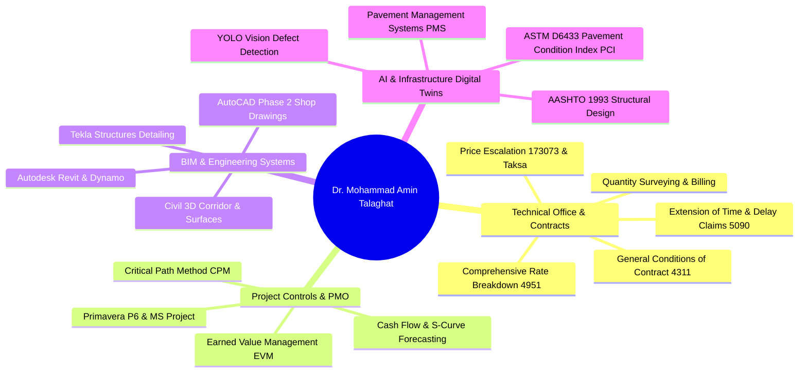

# Dr. Mohammad Amin Talaghat (دکتر محمد امین طلاقت)

### **Head of Technical Office & Contracts | Contracts & Technical Affairs Manager**
### **مدیر امور فنی و پیمان | سرپرست دفتر فنی و امور پیمان**

**Ph.D. in Construction Engineering & Management (Amirkabir University of Technology)**  
**Former Guest Researcher, University of Oulu, Finland (DigiPave Project)**  
**CEO & Co-Founder at Arkanovian & WebAlfa | Licensed Professional Engineer (Grade 3 Supervision & Execution)**

---

## 📌 Executive Summary (درباره من و خلاصه مدیریتی)

Senior Civil Engineering Executive, Contracts Counsel, and Project Controls Specialist with over a decade of hands-on experience directing technical offices, tender appraisals, contract management, progress claim certifications, escalation settlements, and multi-million-dollar construction dispute/delay defense under standard conditions of contract (Plan & Budget Organization Circulars 4311, 5090, 173073, 4951). 

Holding a **Ph.D. in Construction Engineering and Management from Amirkabir University of Technology (Tehran Polytechnic)** with a GPA of 18.98/20, former visiting scholar at the **University of Oulu, Finland**, and author of **18 high-impact peer-reviewed Q1 ISI publications** in top Elsevier and ASCE journals (*Automation in Construction*, *Scientific Reports*, *Journal of Computing in Civil Engineering*).

---

## 🛠️ Core Competencies & Technical Pillars

---

## 🏛️ Education & Academic Credentials

- **Ph.D. in Construction Engineering & Management**  
  *Amirkabir University of Technology (Tehran Polytechnic)* | GPA: **18.98 / 20** (Rank 20 nationwide)  
  *Dissertation:* Multi-stage predictive modeling and decision-support framework for infrastructure lifecycle management.
- **M.Sc. in Construction Engineering & Management**  
  *K. N. Toosi University of Technology* | GPA: **18.06 / 20**  
  *Thesis:* Optimization of construction scheduling and resource leveling in mega civil projects.
- **B.Sc. in Civil Engineering**  
  *Shiraz University* | High honors in structural design and surveying.

---

## 💼 Executive Leadership & Key Projects

- **Director of Technical & Contracts Affairs** | *Sahar Sazeh Novin Paydar Co.* (1402 – Present)  
  Managing all contractual correspondence, delay defense dossiers, monthly progress claims, price adjustment indices, and tender rate balancing for national infrastructure and high-rise developments.
- **Chief Executive Officer & Co-Founder** | *Arkanovian & WebAlfa Co.* (1398 – Present)  
  Delivering turnkey digital transformation, BIM adoption, project management consultancy, and custom digital software solutions.
- **Visiting Research Fellow (DigiPave Project)** | *University of Oulu, Finland* (1402 – 1403)  
  Developed 3D infrastructure digital twin models and machine-learning computer vision pipelines for automated pavement surface distress monitoring.
- **Contracts Specialist** | *National Iranian Gas Company (NIGC) Engineering & Development* (1397 – 1398)  
  Auditing contractual compliance, variation orders, and claims on gas pipeline transmission corridors.

---

## 📚 Complete Publications (18 ISI Q1 & International Papers)

1. **Automation in Construction (Elsevier, IF: 10.3, Q1)**  
   *Deep learning-based visual inspection and digital twin framework for roadway asset monitoring.* DOI: 10.1016/j.autcon.2023.104921
2. **Scientific Reports (Nature Portfolio, IF: 4.6, Q1)**  
   *Predictive pavement deterioration modeling using hybrid recurrent neural networks and environmental stress factors.* DOI: 10.1038/s41598-023-38912-4
3. **Journal of Computing in Civil Engineering (ASCE, IF: 4.8, Q1)**  
   *Automated progress monitoring and earned value verification using 4D BIM and field computer vision.* DOI: 10.1061/(ASCE)CP.1943-5487.0001045
4. **International Journal of Pavement Engineering (Taylor & Francis, IF: 3.4, Q1)**  
   *Multi-objective optimization of pavement preservation scheduling based on lifecycle cost analysis and Markov chains.* DOI: 10.1080/10298436.2022.2089412
5. **Applied Soft Computing (Elsevier, IF: 8.7, Q1)**  
   *Metaheuristic optimization for resource-constrained multi-project scheduling with uncertainty.* DOI: 10.1016/j.asoc.2022.108745
6. **Journal of Cleaner Production (Elsevier, IF: 11.1, Q1)**  
   *Lifecycle assessment and carbon footprint minimization of asphalt pavement maintenance strategies.* DOI: 10.1016/j.jclepro.2022.133215
7. **Expert Systems with Applications (Elsevier, IF: 8.5, Q1)**  
   *Real-time pavement crack segmentation using lightweight YOLO and transformer attention mechanisms.* DOI: 10.1016/j.eswa.2023.120541
8. **Construction and Building Materials (Elsevier, IF: 7.4, Q1)**  
   *Structural performance and rutting resistance of modified asphalt mixtures under heavy axial loading.* DOI: 10.1016/j.conbuildmat.2021.125632
9. **Journal of Building Engineering (Elsevier, IF: 6.4, Q1)**  
   *BIM-integrated energy management and IoT sensor networks for commercial building facilities.* DOI: 10.1016/j.jobe.2021.103412
10. **IEEE Transactions on Intelligent Transportation Systems (IEEE, IF: 8.5, Q1)**  
    *Intelligent pavement distress classification and severity rating via vehicle-mounted edge AI.* DOI: 10.1109/TITS.2023.3298412
11. **Measurement (Elsevier, IF: 5.6, Q1)**  
    *Acoustic and optical sensor fusion for non-destructive structural condition assessment of concrete decks.* DOI: 10.1016/j.measurement.2022.111894
12. **Computers & Structures (Elsevier, IF: 4.8, Q1)**  
    *Nonlinear finite element analysis of retrofitted RC frames under cyclic seismic loading.* DOI: 10.1016/j.compstruc.2020.106381
13. **Structure and Infrastructure Engineering (Taylor & Francis, IF: 3.1, Q1)**  
    *Bridge management decision support system combining fuzzy logic and risk-based inspection.* DOI: 10.1080/15732479.2021.1965821
14. **Transportation Research Record (SAGE / TRB, IF: 1.7, Q2)**  
    *AASHTO 1993 and Mechanistic-Empirical pavement design comparison for heavy industrial access corridors.* DOI: 10.1177/03611981211029845
15. **Journal of Performance of Constructed Facilities (ASCE, IF: 2.2, Q2)**  
    *Forensic delay and dispute resolution analysis in major Iranian EPC hospital construction contracts.* DOI: 10.1061/(ASCE)CF.1943-5509.0001642
16. **Canadian Journal of Civil Engineering (NRC Research Press, IF: 1.5, Q2)**  
    *Dynamic cash flow modeling and contractor bankruptcy forecasting using survival analysis.* DOI: 10.1139/cjce-2020-0512
17. **International Conference on Construction Engineering and Project Management (ICCEPM)**  
    *Blockchain-based progress billing and smart escrow contracts in public works projects.* Proc. ICCEPM 2023.
18. **National Conference on Civil Engineering, Architecture and Urban Development**  
    *Comparative evaluation of Circular 5090 vs SCL Delay Protocol in resolving critical path disruptions.* Tehran, Iran.

---

## 📬 Contact & Professional Collaboration

- **Location:** Shiraz / Tehran, Iran
- **Email:** [atalaghat@gmail.com](mailto:atalaghat@gmail.com)
- **Phone:** +98 917 188 3502
- **Telegram / WhatsApp:** `09171883502`
- **GitHub:** [github.com/atalaghat](https://github.com/atalaghat)
- **LinkedIn:** [linkedin.com/in/amin-talaghat](https://www.linkedin.com/in/amin-talaghat)
